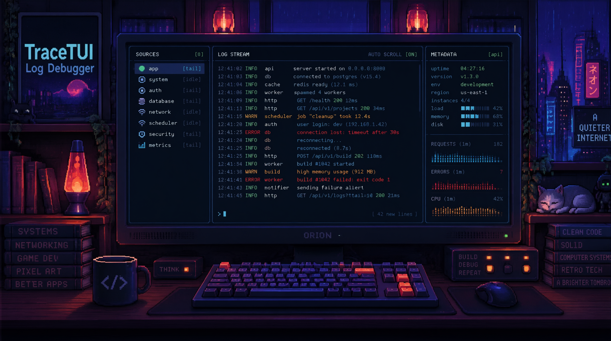

# TraceTUI

<p align="left">
  <a href="./README.md">🇺🇸 English</a> • 
  <a href="./README.ru.md">🇷🇺 Русский</a>
</p>

**Interactive TUI debugger for logs** — a beautiful console interface built on [Textual](https://textual.io/) that parses logs (`loguru`, `logging`) in real-time, highlights errors, and lets you filter them with arrow keys.




## ✨ Features

### Three-panel interface
- **Left panel** — list of log sources/files with activity indicators
- **Center panel** — log stream with color-coded severity levels
- **Right panel** — selected entry details (traceback, metadata, tags)

### Log formats
- **loguru** — `2024-01-15 10:30:45 | ERROR | module.py:42 - message`
- **logging** — `2024-01-15 10:30:45,123 - module.name - ERROR - message`
- **Simple** — `ERROR - message`
- **Auto-detect** — automatic format detection

### Navigation & Control

#### Log navigation
- `↑` / `↓` — navigate through logs (by line)
- Error blocks are highlighted on hover

#### Source switching
- `←` / `→` — switch between sources/log files
- Active source is marked with `▸` in the left panel

#### Keyboard shortcuts
| Key | Action | Description |
|-----|--------|-------------|
| `F` | Filter | Filter mode — type text to search |
| `E` | Next Error | Jump to next error (skip INFO/DEBUG) |
| `T` | Theme | Switch theme (light/dark) |
| `Q` | Quit | Exit the application |

#### Additional capabilities
- Copy traceback to clipboard
- Add custom tags (labels)
- Filter by level and text
- Multiple log file support
- **Timeline Merge Mode** (`m`) — cross-file event timeline with color-coded source tags

## 📦 Installation

### Via pip
```bash
pip install tracetui
```

### From source
```bash
git clone <repository-url>
cd TraceTUI
pip install -e .
```

### Dependencies
- Python >= 3.10
- textual >= 1.0.0
- rich >= 13.0.0

## 🚀 Usage

### Quick start
```bash
# Run with sample logs
tracetui sample_logs/app_standard.log
tracetui sample_logs/app_loguru.log

# Multiple files
tracetui log1.log log2.log log3.log

# With format specification
tracetui -f loguru my_app.log
tracetui -f logging server.log

# Multiple files (timeline mode — press m in UI)
tracetui app.log worker.log scheduler.log

# Filter by level
tracetui -l ERROR app.log
```

### Programmatic usage
```python
from tracetui.app import TraceTUIApp
from tracetui.parsers.log_parser import load_log_source
from pathlib import Path

app = TraceTUIApp()

# Load a file
source = load_log_source(Path("app.log"))
app.add_log_source(source)

# Run
app.run()
```

## 🧪 Testing

```bash
# Run all tests
pytest

# With verbose output
pytest -v

# With coverage
pytest --cov=tracetui --cov-report=html
```

## 📝 Usage examples

### Debugging an app with many errors
```bash
# Open a log with auto-detect format
tracetui /var/log/myapp.log

# Navigate with arrows to ERROR
# Press Enter to view details
# Check the traceback in the right panel
# Press 'd' to mark as "investigate"
```

### Monitoring multiple files
```bash
# Open several logs simultaneously
tracetui app.log worker.log scheduler.log
```

## 📄 License

MIT

---
