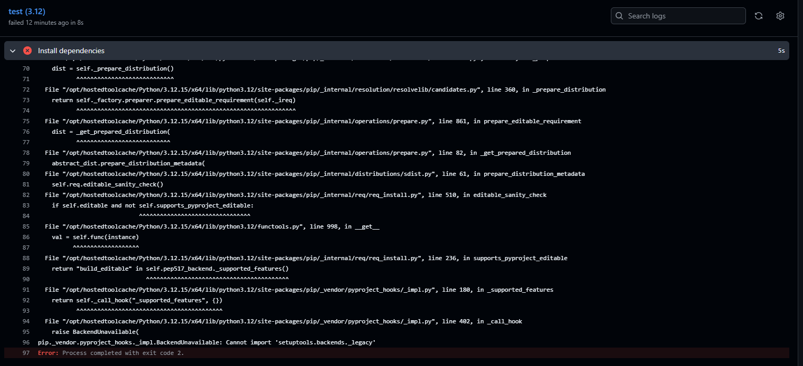

# TraceTUI

**Интерактивный TUI-дебаггер для логов** — красивый консольный интерфейс на базе [Textual](https://textual.io/), который парсит логи (`loguru`, `logging`) в реальном времени, подсвечивает ошибки и позволяет фильтровать их стрелками.


## ✨ Возможности

### Трёхпанельный интерфейс
- **Левая панель** — список источников/файлов логов с индикаторами активности
- **Центральная панель** — поток логов с цветовой кодировкой уровней
- **Правая панель** — детали выбранной строки (traceback, метаданные, теги)

### Цветовая кодировка
| Уровень | Цвет | Иконка |
|---------|------|--------|
| `DEBUG` | Серый | ⚬ |
| `INFO` | Белый | ℹ |
| `WARNING` | Оранжевый | ⚠ |
| `ERROR` | Красный | ✕ |
| `CRITICAL` | Яркий красный | ✕ |

### Форматы логов
- **loguru** — `2024-01-15 10:30:45 \| ERROR \| module.py:42 - message`
- **logging** — `2024-01-15 10:30:45,123 - module.name - ERROR - message`
- **Simple** — `ERROR - message`
- **Auto-detect** — автоматическое определение формата

### Навигация и управление


#### Движение по логам
- `↑` / `↓` — навигация по логам (по строкам)
- Блоки ошибок подсвечиваются при наведении

#### Переключение источников
- `←` / `→` — переключение между источниками/файлами логов
- Активный источник отмечен маркером `▸` в левой панели

#### Горячие клавиши
| Клавиша | Действие | Описание |
|---------|----------|----------|
| `F` | Filter | Режим фильтрации — введите текст для поиска |
| `E` | Next Error | Переход к следующей ошибке (пропуск INFO/DEBUG) |
| `T` | Theme | Переключение темы (светлая/тёмная) |
| `Q` | Quit | Выход из приложения |

#### Дополнительные возможности
- Копирование traceback в буфер обмена
- Добавление пользовательских меток (тегов)
- Фильтрация по уровню и тексту
- Поддержка нескольких файлов логов одновременно



## 📦 Установка

### Через pip
```bash
pip install tracetui
```

### Из исходников
```bash
git clone <repository-url>
cd TraceTUI
pip install -e .
```

### Зависимости
- Python >= 3.10
- textual >= 1.0.0
- rich >= 13.0.0

## 🚀 Использование

### Быстрый старт
```bash
# Запуск с примерами
tracetui sample_logs/app_standard.log
tracetui sample_logs/app_loguru.log

# Несколько файлов
tracetui log1.log log2.log log3.log

# С указанием формата
tracetui -f loguru my_app.log
tracetui -f logging server.log

# Фильтрация по уровню
tracetui -l ERROR app.log
```

### Программное использование
```python
from tracetui.app import TraceTUIApp
from tracetui.parsers.log_parser import load_log_source
from pathlib import Path

app = TraceTUIApp()

# Загрузка файла
source = load_log_source(Path("app.log"))
app.add_log_source(source)

# Запуск
app.run()
```

## 🏗️ Структура проекта

```
TraceTUI/
├── tracetui/                    # Основной пакет
│   ├── __init__.py              # Версия и метаданные
│   ├── __main__.py              # Точка входа (python -m tracetui)
│   ├── app.py                   # Главное TUI приложение
│   ├── cli.py                   # CLI интерфейс (argparse)
│   ├── models.py                # Модели данных (LogEntry, LogLevel, LogSource)
│   ├── parsers/                 # Парсеры логов
│   │   ├── __init__.py
│   │   └── log_parser.py        # LogParser (loguru, logging, simple)
│   └── widgets/                 # TUI виджеты
│       ├── __init__.py
│       ├── source_panel.py      # Левая панель (источники)
│       ├── log_list.py          # Центральная панель (список логов)
│       └── detail_panel.py      # Правая панель (детали)
├── sample_logs/                 # Примеры логов
│   ├── app_standard.log         # Standard logging формат
│   └── app_loguru.log           # Loguru формат
├── tests/                       # Тесты
│   ├── conftest.py
│   ├── test_models.py
│   └── test_parsers.py
├── pyproject.toml               # Конфигурация пакета
└── README.md
```

## 🧪 Тестирование

```bash
# Запуск всех тестов
pytest

# С отчетом
pytest -v

# С покрытием
pytest --cov=tracetui --cov-report=html
```

## 📝 Примеры использования

### Отладка приложения с множеством ошибок
```bash
# Открываем лог с автоопределением формата
tracetui /var/log/myapp.log

# Нavigируем стрелками до ERROR
# Нажимаем Enter для просмотра деталей
# Смотрим traceback в правой панели
# Нажимаем 'd' чтобы пометить как "исследовать"
```

### Мониторинг нескольких файлов
```bash
# Открываем несколько логов одновременно
tracetui app.log worker.log scheduler.log
```

## 🔧 Для разработчиков

### Добавление нового формата парсера
1. Создать класс парсера в `tracetui/parsers/`
2. Добавить паттерн regex в `LogParser`
3. Реализовать метод `_parse_new_format()`
4. Добавить тесты в `tests/test_parsers.py`

### Стилевая настройка
CSS для виджетов находится в `tracetui/app.py` в атрибуте `CSS` класса `TraceTUIApp`.

## 📄 Лицензия

MIT

---
